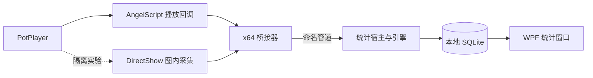

# PotTrace

面向 **64 位 PotPlayer** 的本地播放统计扩展。记录影片的有效打开次数、实际播放时长、独立观看片段和高频观看区间，并通过与播放器风格协调的 WPF 窗口查看历史。

**当前为开发预览，尚未完成稳定版验收。** 已实现功能经过自动化测试和隔离实播验证；启动回调延迟、实验采集器的兼容性等限制仍需留意。预览合并验收见 [develop 合并验证](docs/develop-validation.md)，正式采集器的新进展与未通过门槛见 [稳定版开发验收](docs/stable-validation.md)。

[功能](#功能) · [统计规则](#统计规则) · [安装与使用](#安装与使用) · [数据管理](#数据管理) · [开发与构建](#开发与构建) · [验证](#验证) · [已知限制](#已知限制) · [文档导航](#文档导航)

## 功能

| 功能 | 说明 |
| --- | --- |
| 精简统计 | 按文件名汇总有效打开次数、累计实际播放时长和最近打开时间 |
| 详细统计 | 保存观看会话、连续播放片段及现实时间轴，重复观看独立记录 |
| 高频区间 | 展示媒体时间区间的观看覆盖次数，按文件来源分别计算 |
| 自动运行 | 首次启用扩展后随 PotPlayer 启动后台，无需每次打开统计窗口 |
| 查询与显示 | 文件名搜索、打开日期筛选、深浅主题和全局快捷键 |
| 采集控制 | 精简／详细采集模式、暂停统计、排除目录 |
| 数据管理 | CSV／JSON 导出、数据库备份与恢复、按筛选删除影片记录 |
| 本地存储 | 使用 SQLite 保存历史，播放记录不上传 |

### 两条采集路径

| 路径 | 当前用途 | 注意事项 |
| --- | --- | --- |
| AngelScript 回调 + x64 桥接器 | 截至 preview.3 的预览包采集方式 | 已观察到首次身份回调延迟，接近 10 秒的有效打开判断可能漏计 |
| DirectShow 图内采集 | 从 preview.4 起随快速包提供 | 1.7.22859.0 / EVR / INI 已做隔离安装和卸载验证；1.7.23172.0 / 内置 D3D11 / 注册表的日用实测见[稳定版开发验收](docs/stable-validation.md) |

DirectShow 路径已在本机 PotPlayer 26.4.22 / EVR 配置验证首开、换片、自动下一集、重复观看和变速记录。早期脚本预览包使用脚本回调，preview.4 快速包使用正式 AX，详见 [图内采集验证](docs/graph-ingestion-validation.md)。

正式采集器位于 `native/PotTrace.Collector`，包含自动加载、采集启停和生命周期管理。在已验证的无渲染窗口 D3D11 配置中，PotTrace 将播放器回调提供的完整路径与视频流的来源核对，并用带影片位置的回调核对启动阶段的样本。可恢复的范围取决于两侧实际取得的观测。配置和开发验证方式见[采集器说明](native/PotTrace.Collector/README.md)。

## 统计规则

以下是统计引擎的计入规则；结果依赖采集器能够可靠确认的影片身份、状态和时间。

| 项目 | 计入方式 |
| --- | --- |
| 有效打开 | 当前影片已确认的播放或暂停停留累计**严格超过 10 秒**，才计为一次；恰好 10 秒不计 |
| 播放队列 | 仅加入队列、尚未成为当前影片的文件不计入；预加载不代表已经开始观看 |
| 累计时长 | 按实际经过的播放时间累计，暂停不增加播放时长；有效会话会追认此前可靠记录的播放时间 |
| 详细片段 | 连续实际播放**严格超过 5 秒**才进入详细列表；恰好 5 秒不进入 |
| 短片段 | 有效会话中的短片段仍计入累计播放时长，但不进入详细片段和热区统计 |
| 重复观看 | 每次观看分别计时、按真实发生顺序保存，不合并重复媒体区间 |
| 分段边界 | 暂停、跳转、循环回绕、缓冲、结束、换片或无法确认的连续性会切断片段 |
| 连续变速 | 单纯变速不切分连续片段；已采集的变速事件另存于时间轴 |
| 同名影片 | 按完整文件名归并，包含扩展名、忽略大小写；不同目录的同名文件汇总到同一影片 |
| 来源与热区 | 完整来源及文件版本分别识别；同名归并不会把不同来源的热区混在一起 |

例如：确认打开后暂停 12 秒，可计一次有效打开，播放时长为 0；以 2 倍速实际播放 6 秒，累计播放为 6 秒，媒体位置通常前进约 12 秒。同一区间连续观看两次且各自超过 5 秒，会保留两条明细，重叠区间覆盖次数为 2。

**查看模式与采集模式不同：** 界面的“精简／详细”切换展示内容；设置中的采集模式决定是否保存明细，并从下一次观看会话生效。默认采集模式为精简，旧的精简记录不能补出详细时间轴。

图内采集的速度是采样估计，未知倍率保存为 `null`，不当作 1 倍速。连续片段的倍率可表示平均观测速度；变速事件及采样观测窗口可通过 JSON 导出，窗口不保证包含用户实际操作时刻。当前 WPF 时间轴展示播放片段，不单独绘制变速事件标记。

## 安装与使用

### 运行环境

- 目标平台：Windows 10／11 x64、64 位 PotPlayer。
- 已归档实测环境：Windows 10.0.26300、PotPlayer 26.4.22；实验图内链路使用 EVR。其他版本和渲染器不能据此视为已兼容。
- 完整预览包为 Windows x64 自包含程序，使用者无需另装 .NET SDK。包内不包含 PotPlayer。

仓库源码不包含构建产物和隔离播放器。已验证的 `0.1.0-preview.2` 是本地预览构建，不能据此认为 GitHub 上已有可下载发行包；可按下文从源码生成安装包。

### 快速安装、卸载与打开统计

解压带有快速入口的预览包，退出 PotPlayer 和 PotTrace，双击 **快速安装.cmd** 选择播放器。首次在 F5 → 扩展功能 → 播放统计勾选 PotTrace。按 **Ctrl+Alt+Shift+H** 可启动统计窗口，后台已运行时也可使用默认的 **Ctrl+Alt+H**。退出两个程序后双击 **快速卸载.cmd**，选择原播放器即可卸载并保留历史。

### 首次安装

1. 解压完整预览包，退出目标 PotPlayer 和已运行的 PotTrace。
2. 在解压目录执行安装命令，将播放器路径替换为自己的实际路径：

   ```powershell
   powershell.exe -NoProfile -ExecutionPolicy Bypass -File .\Install.ps1 -PotPlayerPath 'E:\pot\PotPlayer'
   ```

3. 打开 PotPlayer，在 **选项（F5）→ 扩展功能 → 播放统计** 中勾选 **PotTrace**。
4. 打开影片，通过托盘或程序目录中的“播放统计”快捷方式查看状态。需要明细时，先在设置中选择“详细”采集，再打开影片。

首次启用后，后台由播放器扩展自动启动，不注册 Windows 开机启动项。仅显示“已连接”不足以证明当前影片已经被识别；还需确认影片信息和超过阈值后的有效会话记录。

### 日常操作

- 关闭统计窗口会隐藏到托盘，后台继续采集。
- “暂停统计”会停止记录，设置在重启后保持；恢复记录需主动取消暂停。
- 托盘中的“退出 PotTrace”会停止本轮播放器的自动重启；手动启动 PotTrace 或重开播放器后可恢复连接。
- 日期筛选按会话打开日期选择完整会话；跨日播放另存按日时长事实。
- 升级前退出播放器及后台，对已有安装重新执行安装脚本；升级保留历史和设置。

### 卸载

退出播放器和 PotTrace，在预览包目录执行：

```powershell
powershell.exe -NoProfile -ExecutionPolicy Bypass -File .\Uninstall.ps1 -PotPlayerPath 'E:\pot\PotPlayer'
```

默认保留历史和设置。明确需要移除登记的统计数据时才添加 `-RemoveHistory`。安装目录、数据目录的自定义参数及完整步骤见 [安装与使用说明](docs/installation.md)。

## 数据管理

| 内容 | 默认位置／格式 |
| --- | --- |
| 程序与快捷方式 | `%LocalAppData%\Programs\PotTrace` |
| 数据目录 | `%LocalAppData%\PotTrace` |
| 观看历史 | `pottrace.db`，SQLite 数据库 |
| 采集设置 | `settings.json` |
| 异常诊断 | `diagnostics.log`，出现异常时写入 |
| CSV 导出 | 当前筛选范围内的会话汇总 |
| JSON 导出 | 当前筛选范围内的会话、片段和已保存的时间轴事件 |

导出不受界面分页限制。数据库和导出文件包含文件来源路径、打开时间及播放行为，分享前请检查内容。

建议通过界面的“备份数据库”创建备份。恢复会暂停采集，并保存独立的 `pottrace.db.before-restore-<唯一编号>` 安全副本；重复恢复不会覆盖已有副本。损坏或结构不完整的备份会被拒绝，程序不会通过自动删除数据库来处理损坏。

删除活动会话后，本次打开期间不会重新补记该会话，避免重试事件把已删除记录重新写入。更多行为说明见 [安装与使用说明](docs/installation.md)。

## 实现结构



桥接器将播放事件发送给独立宿主。引擎负责会话、计时与片段规则，存储层负责事务、重放去重和查询；只有数据库提交后才确认事件。实验图内采集使用连接来源、渲染器归属和生命周期观测确认当前影片，不从窗口标题猜测身份。

## 开发与构建

### 开发依赖

| 依赖 | 仓库要求 |
| --- | --- |
| .NET SDK | `global.json` 指定 10.0.404，允许同版本带内的较新补丁 |
| Visual Studio | Visual Studio 2026，安装 C++ 构建工具和 Windows SDK |
| CMake／CTest | 可通过 PATH 找到，CMake 需支持 `Visual Studio 18 2026` 生成器 |
| PowerShell | 推荐使用 Windows PowerShell 5.1 运行仓库脚本 |
| Pester | 测试脚本显式要求 3.4.0；可用 `Get-Module -ListAvailable Pester` 检查 |

构建脚本会自动还原 NuGet 依赖；缓存缺失时需要网络。`scripts/dotnet.ps1` 优先使用仓库内的 `.tools/dotnet/dotnet.exe`，其次查找隔离 worktree 的共享工具目录，最后使用 PATH 中的 `dotnet`。

CMake／CTest 找不到时，脚本还会尝试原开发机的固定路径。其他机器应将自己的工具目录加入 PATH；当前构建脚本固定使用 VS 2026 生成器，并非任意 Visual Studio 版本都可直接运行。

### 构建与测试

在仓库根目录执行：

```powershell
# 首次准备固定版本的 DirectShow baseclasses（构建时校验源码和许可证哈希）
python probes/DirectShowProbe/fetch_baseclasses.py

# Release 应用、桥接器、正式采集器及原生测试
powershell.exe -NoProfile -ExecutionPolicy Bypass -File .\scripts\build.ps1 -Configuration Release

# 托管测试、Release 原生测试、安装与升级回滚测试
powershell.exe -NoProfile -ExecutionPolicy Bypass -File .\scripts\test.ps1
```

测试前需要完成 Release 构建，以生成 `out/native` 下的原生测试程序。调试构建可使用 `build.ps1 -Configuration Debug`。包含中文的 PowerShell 脚本使用 UTF-8 BOM，以兼容 Windows PowerShell 5.1 的编码识别。

### 生成本地预览包

```powershell
powershell.exe -NoProfile -ExecutionPolicy Bypass -File .\scripts\publish.ps1 -Version '0.1.0'
```

输出为 `artifacts/v0.1.0-win11-x64-potplayer-dev.zip` 及同名目录。开发版包含自包含程序、正式 DirectShow AX、桥接 DLL、快速安装和卸载入口、使用说明与 SHA-256 文件清单。

打包脚本会保留已存在的同名发行包。

## 验证

2026-11-17 已归档的 develop 合并验收包括：

- 70 项托管测试、7 组原生测试、7 项脚本及安装测试全部通过，合并后在主工作区重新构建并复测。
- Release 桥接与 Release 宿主完成隔离实播：首次启动、暂停停留、重复观看、后台故障恢复、同名换片、队列排除、预加载暂停与自动下一集。
- 半速／低帧率、1.1 倍速、2 倍速往返，以及严格 5 秒／10 秒门槛已有独立实播记录。
- 中文路径下的本地自包含包安装、启动、正常退出、卸载保留历史通过。

完整证据、失败轮次和适用边界见 [合并验证报告](docs/develop-validation.md)与 [图内采集验证](docs/graph-ingestion-validation.md)。测试数量是该次验收快照，不代表后续修改自动通过，也不等同于稳定版部署验收。

### 模拟器

可回放仓库提供的事件场景，验证协议与统计规则，无需启动播放器：

```powershell
powershell.exe -NoProfile -ExecutionPolicy Bypass -File .\scripts\dotnet.ps1 run --project .\tools\PotTrace.Simulator -- --scenario .\tools\PotTrace.Simulator\scenarios\pause-only.json
```

模拟器还支持 `--seed <新数据库路径>` 生成示例历史，目标文件必须不存在。模拟事件通过不能替代 PotPlayer 的真实兼容性验证。

### 隔离实播

[播放器探针](probes/PotPlayerProbe/README.md)和 [DirectShow 探针](probes/DirectShowProbe/README.md)供开发验证使用。需要另行准备隔离播放器和 Python 依赖；脚本部分路径沿用开发机约定，不能视作克隆仓库后即可运行的通用安装器。

DirectShow 探针使用生成媒体与独立数据库，限定播放器位于 `out/`，退出后恢复副本配置和桥接文件。请按探针文档准备环境，不要将实验滤镜直接安装到日用播放器。测试记录位于 `out/`，不会随源码提交。

## 已知限制

- **脚本启动延迟：** 已观察到约 1.7–8 秒的首次回调延迟，正常显示启动也有约 2 秒的偶发延迟。首次打开后立即暂停、停留接近有效阈值的情况可能漏计，不能在身份尚未确认时虚构补齐记录。
- **图内采集尚未产品化：** 正式采集模块提取、安装器接入、禁用／卸载与回退兼容性仍未完成；新版内置 D3D11 渲染器尚无已验证的归属证明。
- **采样精度：** 不保证逐帧记录或捕获短于采样间隔的往返跳转。未知区间不补算，观测停滞时可能保守分段；不足 5 秒的部分仍受详细片段门槛限制。
- **待验收场景：** 真实缓冲、系统睡眠唤醒、长时资源稳定性、短促连续变速、AB／整片循环及更多系统和播放器版本。
- **大历史与功能范围：** 详细会话列表最多展示最近 1000 次，完整记录可导出；来源热度会加载该来源全部有效片段，超大历史仍需优化。手工合并影片／来源热度尚未实现。

## 常见问题

**为什么看不到记录？**

确认已勾选 PotPlayer 扩展、统计未暂停、影片未位于排除目录，并且当前影片的可靠停留已超过 10 秒。仅入队不会产生记录；首次回调延迟也可能影响短会话。查看界面状态和数据目录中的诊断日志。

**为什么累计时长有值，详细列表却为空？**

该会话可能以精简模式采集，或者所有连续播放片段都未超过 5 秒。切换“详细”查看不能补采历史；需在设置中启用详细采集，并从下一会话开始记录。

**为什么暂停 12 秒有打开次数，却没有播放时长？**

暂停计入有效停留，不计入实际播放；在可靠采集到完整停留的前提下，这是预期行为。

**WebView2 目录报错是否来自统计界面？**

统计窗口使用 WPF，不依赖 WebView2。已记录的该类报错来自隔离播放器的数据目录访问；探针使用独立的 `WEBVIEW2_USER_DATA_FOLDER`，不会通过修改用户目录权限来绕过错误。

## 仓库目录

```text
plugin/                    PotPlayer AngelScript 扩展
native/PotTrace.Bridge/    C++ x64 桥接器与图事件处理
native/PotTrace.Collector/ 正式图内采集器（开发预览快速包）
src/PotTrace.Contracts/    事件协议、帧编码与校验
src/PotTrace.Core/         会话、计时、片段和热区规则
src/PotTrace.Storage/      SQLite、查询、事务及备份
src/PotTrace.App/          WPF 窗口、后台宿主与设置
tests/                    托管、原生及安装回归测试
tools/PotTrace.Simulator/  示例数据与事件回放
probes/                   隔离播放器及图内采集实验
packaging/                安装、卸载脚本
scripts/                  SDK 定位、构建、测试与打包
docs/                     使用说明、设计和验收证据
```

`.tools/`、`out/`、`artifacts/` 和各项目的 `bin/obj` 为本地工具、证据或构建目录，已列入 Git 忽略规则。

## 文档导航

| 文档 | 内容 |
| --- | --- |
| [安装与使用](docs/installation.md) | 安装参数、启用、运行、备份与卸载 |
| [稳定版开发验收](docs/stable-validation.md) | 正式采集器增量、保留失败及后续发布门槛 |
| [develop 合并验证](docs/develop-validation.md) | 开发预览的最新归档验收与边界 |
| [DirectShow 在线统计验证](docs/graph-ingestion-validation.md) | 图内接入、变速修复和实播证据 |
| [DirectShow 来源验证](docs/directshow-validation.md) | 影片身份、载入边界和渲染器兼容性 |
| [启动漏计调查](docs/startup-investigation.md) | 回调延迟问题与已有修复 |
| [前阶段验收记录](docs/acceptance.md) | 脚本链路、生命周期和安装包验证 |
| [总体设计](docs/superpowers/specs/2026-11-16-pottrace-design.md) | 功能范围与统计规则设计 |
| [实施计划](docs/superpowers/plans/2026-11-16-pottrace-implementation.md) | 开发步骤与后续工作 |

反馈问题时，请说明 PotPlayer 版本与位数、渲染器、采集路径、复现步骤及期望结果，并提供去除私人文件路径后的相关日志。请区分安装包问题与隔离探针问题，便于定位。
