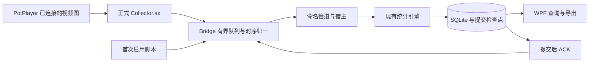

# PotTrace 首个稳定版设计

日期：2026-11-18。状态：待用户审阅的开发方案，未实施、未通过稳定版验收。

本设计承接已确认的图内采集方案、连续变速规则及“先隔离验证，全部通过后部署”。首个支持目标沿用 PotPlayer 26.4.22 x64 / EVR；下文新增的资源上限、验收轮数及版本策略是本次工程建议，不代表已经实测或用户另行确认。

## 1. 现状与交付目标

当前代码已完成 DirectShow 实验采集 → 原生桥接 → 命名管道 → C# 统计引擎 → SQLite → WPF 查询/导出的链路。历史验证记录包含托管 70 项、原生 7 组、安装脚本 7 项，以及隔离实播；详见[开发预览验收](../../develop-validation.md)和[图内统计验证](../../graph-ingestion-validation.md)。这些结果是已有证据，不替代本设计的新增验证。

当前正式预览包没有实验 AX，仍走有启动身份回调延迟的脚本路径。实验 AX 的进程内线程、模块持有和诊断输出也尚未产品化。合并 master 不等于稳定发布。

交付目标是：用户首次启用后，受支持的 PotPlayer 配置自动加载正式采集模块；当前影片的身份、已确认停留、实际播放及明细可追溯；故障不阻塞播放，缺口可见；安装、升级、卸载和失败回退均保护用户配置与历史。

首版支持范围：已验证的 Windows x64 环境、PotPlayer 26.4.22 x64、EVR、本地普通视频文件。以测试时的播放器二进制哈希和配置指纹标定实际支持组合。MKV/MP4、H.264/H.265、软解/硬解、可变帧率及低帧率分别验证，未通过的组合不进入支持清单。网络流、DVD/蓝光菜单、纯音频及 D3D11 不作首版准确采集承诺。

安装前重新读取 日用播放器目录 的实际版本、位数和渲染配置；与支持清单不符时停止部署并说明原因，不自动改用户渲染器。隔离副本测试成功不能替代正式目标核对。

## 2. 路线选择

| 路线 | 评价与处理 |
| --- | --- |
| 延迟脚本回调后回填启动记录 | 无法证明此前身份和状态；违反准确性优先，不作为稳定采集路径 |
| 载入即暂停，等宿主就绪再播放 | 之前未证明首次打开、切换及预加载全部具备可靠暂停屏障；不增加对播放控制的依赖 |
| 当前连接来源 + 渲染器归属 + 就绪观测 | 延续用户已选择并实播验证的图内采集路线，正式化后作为支持配置的唯一统计权威 |

不同时改写统计引擎或更换数据库。旧脚本保留启用和宿主生命周期职责；图内模式下，其播放事件不能覆盖当前影片。首版不以自动降级到脚本来宣称“完整记录”；未启用图内采集时展示明确状态。

## 3. 统计规则与时间语义

| 项目 | 稳定版必须保持的规则 |
| --- | --- |
| 一次有效打开 | 当前影片已确认停留严格 `>10000ms`；播放、暂停均贡献停留，队列/未成为当前影片的预加载不贡献 |
| 累计播放 | 已确认实际播放墙钟时长；暂停不贡献，2 倍速不把时长翻倍 |
| 详细片段 | 连续确认实播严格 `>5000ms`；短段仍进入累计时长，不伪装成合格明细 |
| 变速 | 连续播放保持同一片段；速度变化作为片段内事件，估计值/观测窗口明确标识 |
| 分段 | 暂停、跳转、真实缓冲、观察缺口、停止/结束切段；重复观看独立保存，按真实时间顺序展示 |
| 归并 | 文件名含扩展名、大小写不敏感归并影片；完整来源和来源版本区分热区，不跨不同剪辑强合热区 |
| 无法证明的时间 | 不补算播放；不能确认仍为当前影片的时间也不补算停留，保留原因和缺口 |

内部持续时间使用单调时钟；UTC 用于展示和日期归属，不能作为唯一排序键。每个播放器 InstanceId 分配持久化 `InstanceOrder`，会话保存 `StartedMonotonicMs`，事件用 sequence、片段用 Order 保持同一播放器跨会话的实际先后。多播放器展示独立轨道；跨实例默认按 InstanceOrder 排列，不宣称它们的入库先后就是严格的全局播放先后。旧记录沿用原顺序并标为 Legacy。系统校时、跨午夜和睡眠不能增加虚假的播放时间；校时事件保留新旧 UTC 锚点，UTC 回拨不重排同一播放器记录。记录 `readyObservedFrom/To`，表示首次可靠就绪查询的时间窗口，绝不称为 PotPlayer 内部的精确载入时刻。

复合查询超过 `50ms` 继续视为无效观测。这个值是失效门槛，不是“误差最多 50ms”的产品承诺。已验证的 NewSegment 边界可以提供片段起点证据，但必须绑定同一来源、generation 和首次就绪；不能单独准入或无条件回填。

短促变速不保证每次按键都产生一个可识别倍率事件。只记录可证明的变化，不伪造中间速度。若常规连续播放仅因采样延迟被切成不足 5 秒的碎片，属于准确性验收失败；不得通过降低阈值或跨未知区间拼接使其“通过”。真实不可观察的故障场景允许明确标注不完整。

## 4. 模块与接口边界

### 4.1 正式采集器

新增 `native/PotTrace.Collector`，产物 `PotTrace.Collector.ax`。独立生产 CLSID 与实验 CLSID 分开；通过 PotPlayer 私有配置加载，不注册全局 COM。把 `ConnectedRenderer`、来源/状态观察、位置观察和 sink 的公共逻辑迁到正式模块，实验工具复用正式代码，避免两套统计实现漂移。DirectShow baseclasses 使用固定版本、校验哈希及保留许可证的构建输入。

安装清单内记录 AX 与 Bridge 的受控绝对路径。生产启动不依赖 `POTTRACE_GRAPH_BRIDGE` 测试环境变量、不搜索工作目录中的 DLL。过滤器加载即可初始化采集缓冲及唤起宿主，不等待晚到的影片脚本回调才开始采样；脚本和滤镜重复初始化必须幂等。

启停的持久化权威为原子写入的 `capture-policy.json`，包含用户启用、暂停统计和递增 revision；安装器/设置界面统一修改它，迁移后的 settings 不保留可独立生效的第二份开关。每个播放器还须满足 PotPlayer 的该插件启用项，并且没有本实例的 UserExit 抑制。首次授权产生策略文件；文件缺失、损坏或插件启用项无法确认时不采集、不缓存身份。AX 在启动工作线程中读取策略和已验证的播放器配置，再开始观察，不等待宿主读设置；禁用状态下仍透明传递视频。

取消 PotPlayer 插件勾选时，OnFinalize 或经验证的配置通知立即关闭本实例采集门；退出播放器同样关闭本实例，但不清除下一次启动的持久化授权。首次启用需证明实际配置读取与取消勾选通知可靠，不能以假定回调顺序替代验收。暂停统计/禁用/用户退出均记录单调截止时间与 policy revision：此前已确认但晚到的数据可以提交，截止后的数据丢弃；恢复不补算禁用区间。用户主动退出宿主后，本次玩家实例不能由 AX 再次拉起宿主，下一次启动按持久化设置恢复。

来源仍取实际上游 `IFileSourceFilter`；渲染器必须属于实际下游连接、同一 PID/主窗口且候选唯一。准备完成要求状态 `S_OK`、Playing/Paused、前后两次来源一致。多候选或归属不明时不准入，显示无法确认的原因。多播放器使用独立 instance/epoch，不能互相抢占来源。

状态/身份与位置查询分离；流线程仅获取既有边界事实和非阻塞入队，不枚举图、不访问磁盘/SQLite、不等待 ACK。诊断默认关闭完整路径和逐样本日志；临时诊断环形文件总上限建议 `10MiB`，用户主动导出时才包含完整路径。

### 4.2 生命周期与阻塞处理

允许每播放器进程持有一次模块直到进程退出；首版不承诺播放中动态卸载 DLL。禁用后立即停止新采集，退出播放器后完成物理卸载。这与无限累积每个旧图的线程/引用不同。

建议固定一个管理线程、两个身份/状态查询槽、两个位置查询槽，总计最多五个 Collector 后台线程。另计现有 Bridge 线程并分别监测。每图每类最多一个未完成查询；最多两个图同时受观察，其他候选只能保持有界元数据，不得先计入播放。

每次查询使用 generation 与取消标记；切换、停止、断开后，过期结果不得提交。析构、回调和播放器退出均不等待可能阻塞的外部 COM 查询。不能强杀 COM 调用线程，也不能在其仍执行时卸载代码。

超过有效查询窗口立即标记未知；如果调用长期不返回，该查询槽被占用，相关图引用只能保留到安全返回或进程结束。所有槽耗尽时停止该进程的采集并显示故障，不继续创建线程。此设计保证资源有上限，不承诺对任意第三方 COM 死锁自动恢复。受支持配置若常规切换就耗尽槽，稳定门槛失败。

复用 `ObservationFence`、`GraphTimeline`、队列 `4096` 项 / `8MiB` 上限和终止事件重试。压力不能阻塞流线程；被丢弃区间必须转成显式缺口，不能用后续累计 ACK 掩盖。最后一条边界是否送达要可诊断；异常进程终止后只保留已提交或可重放证据，不承诺零尾部损失。

### 4.3 协议、统计及质量信息

进程内 ABI 沿用 `PotTraceGraphPacket` v2；增加字段时提升 ABI，不改变旧布局的含义。桥接和宿主启动握手新增独立协议 v2、能力列表及构建标识。只有确认支持 nullable rate、连续变速事件、位置不连续和质量缺口后才进入正式采集；不兼容宿主不得收到新格式事件。版本化管道名防止旧宿主误接收，进程单实例协调同样按兼容性处理，不能让两个版本同时写库。

扩展会话元数据：`CaptureBackend`、`CaptureRuleVersion`、`CaptureStatus`、`ReadyObservedFromUtc`、`ReadyObservedToUtc`、`InstanceOrder`、`StartedMonotonicMs`。质量标记为 `Complete`（受支持观察链完整）、`Incomplete`（存在明确缺口）、`Legacy`（旧记录，未追溯证明）；Complete 不意味着内部载入零误差。缺口事件记录单调起止、原因及关联会话；暂停停留证据和播放证据分别处理。

时间轴事件新增可空 `SegmentId`。连续变速事件关联当前片段；若片段最终不足 5 秒，事件仍保留会话级信息，不生成悬空外键。只有变化确证时写事件，展示估计窗口；不得把片段平均倍率冒充某一次用户设置的精确倍率。短片段可显示在质量/事件视图，但不混入合格明细。

宿主成功提交事件和检查点后才 ACK；重放不增加次数或时长。数据库不可写时明确报错并暂停确认 ACK，有限重试；队列耗尽按上述缺口策略处理。播放器崩溃或断线后的收尾仅到最后可靠观察，重启不得把空白期补作停留。

### 4.4 存储迁移和回退

引入顺序、事务化迁移以及最小可读/可写版本检查。首版新增迁移 `002_capture_quality.sql`，以当前 schema 1 为输入；旧记录新增字段默认 Legacy，不重算旧历史。捕获规则版本与数据库版本分开管理。

升级前停止旧宿主写入，使用 SQLite 备份 API 生成经完整性校验的快照，并记录应用、协议、schema 与清单版本。迁移失败回滚事务；备份失败则不开始迁移。未知高版本数据库必须在反序列化和写操作之前拒绝打开。

现有预览程序没有可靠的高版本拒读逻辑，不能假定旧二进制读到新 schema 会自行退出。稳定版使用独立数据文件 `pottrace-stable.db`，在无写入者时从现有数据库一致性备份导入，再迁移；原文件保留供旧版回退。以后稳定版使用明确的版本检查及配置指针。重新安装不能重复导入并覆盖已有稳定数据库。

应用回退不等于历史回退：旧版只能指向升级前快照/旧文件，不能直接打开新版库。升级后的新增记录保留在新版库，可用匹配版本只读导出；若用户选择恢复旧快照，应明确列出不会出现在旧版中的新增记录范围。绝不静默删除新增历史，回退后产生的两份历史不自动合并。

### 4.5 安装与自动启用

沿用现有文件所有权和 SHA 清单；增加 AX、协议版本、兼容配置及安装事务日志。首次在关闭播放器后安装并启用一次；后续启动自动加载，不添加 Windows 自启动任务。

先识别 PotPlayer 实际配置后端：INI 或用户注册表；首版仅启用已经实现并隔离验证的后端。对不支持的后端提前拒绝，不臆造路径。只增改自己的滤镜 CLSID/启用项，保留其他滤镜、优先级和用户设置。外部修改过的配置在卸载/回退时冲突提示，不整文件覆盖。

流程为预检 → 备份/写事务日志 → 写入旁路版本目录 → 校验清单 → 写自有加载项 → 首次启动健康检查 → 标记成功。健康检查同时验证 AX 已加载、协议握手和生成的测试影片实录，不能只看复制成功。中断后下次运行安装器根据事务日志恢复；升级时若播放器正在占用模块，提示关闭后再继续，不强杀用户播放器。

隔离副本完整演练安装、升级、失败恢复和卸载之后，才按已有授权部署受支持的日用配置。部署过程保留可恢复原配置和历史；一次正式安装冒烟不能替代此前完整验证。

### 4.6 UI 和大历史

沿用 WPF/PotPlayer 风格。加入“正在记录、等待当前影片确认、当前配置不支持、记录存在缺口、存储异常”状态与简短原因；暂停状态展示已确认停留仍增长、实播不增长。时间轴可查看变速事件及其估计窗口、缺口和分段原因。

支持分页查询及取消；热区按完整来源计算，长历史不一次加载所有 Segment；CSV/JSON 流式导出，顺序和现有统计口径不变。首版性能目标为参考机器上 10 万会话/100 万片段：首次列表 P95 ≤1 秒、可取消查询不冻结 UI、导出和热区计算的工作内存不随记录数线性增长。此为待测目标，非现有性能承诺。

## 5. 验收与发布门槛

所有实播使用生成媒体、隔离播放器、独立数据库；同一播放器副本不并行运行测试。每轮保存构建哈希、播放器/配置指纹、输入、原生观测、数据库、结果及失败证据；路径信息仅留本地诊断资料。

| 门槛 | 必须覆盖和通过的条件 |
| --- | --- |
| G1 规则确定性 | 单元输入 10000/10001ms、5000/5001ms 边界；暂停只增停留；同名归并；重放幂等；速度变化不切连续片段；真实缺口必须切段 |
| G2 真实链路 | 首启、暂停停留、快速切换、同路径重开、预加载取消、自动下一集、双播放器；0.5/1/1.1/2 倍速及快速往返、低帧率、拖动、AB/整片循环、EOF 尾部；零错归属、零重复计数、正常场景零未解释缺口 |
| G3 故障恢复 | 阻塞 COM/慢查询、宿主崩溃、播放器崩溃、管道断开/队列满、数据库只读/磁盘不足、校时；真实 Windows 睡眠/唤醒至少 3 轮。进程挂起测试不能代替系统睡眠 |
| G4 长稳 | 同一 Release 包连续运行至少 24 小时、至少 500 次换片；前 50 次预热后每 50 次清空队列采样资源。结束后线程和 COM 引用回到既定活动基线，不能随次数递增；原生采集自有堆末 5 个采样最大值减最小值 ≤8MiB，句柄差 ≤10；零插件归因崩溃/卡死 |
| G5 安装回退 | 干净安装、预览导入、稳定版覆盖升级、重复安装、加载项冲突、中文/空格路径、配置外部修改、失败注入、卸载保留历史；全流程配置/文件所有权成立，SQLite 完整性通过 |
| G6 UI 与数据 | 100%/150%/200% DPI、小窗口、长片名；10 万会话/100 万片段；页面、明细、热区和导出一致；取消查询/导出后无残留写操作 |

准确性证据不能只对比“操作按钮时间”和数据库，也不能仅用同一采样器自证。确定性回放验证计算精确值；真实首次载入使用命令边界、源/渲染器原生窗口及带时间码合成视频的独立画面观察交叉核对。边界不明时报告范围，禁止宣称零延迟。

建议先对每个首启/切换/下一集场景运行 20 次。外部见证的起止合成不确定度必须 ≤100ms；无法达到时结果为 NOT_RUN/测量不足，不允许加宽容差后通过。1 倍速连续片段实播偏差不得超过已测得的不确定度再加 100ms，整轮会话累计偏差不超过该不确定度再加实际时间的 0.5%。阈值判断以确定性测试为准，真实 4.9/5.1 秒和 9.9/10.1 秒用例作为交叉检查。无法解释的首段缺失仍阻断发布，即使累计误差碰巧达标。

停留与实播分别验收：受控图夹具为来源切换及 renderer ready 提供已知边界，验证载入即暂停、首个 ready 窗口和严格停留阈值；真实播放器先用独立画面确认当前影片，再确认暂停状态，对这段已确认暂停的停留增量逐段核对。暂停或 1fps 画面本身不能给出精确载入时刻，也不能充当持续播放计时器；这些用例通过受控图时间线、独立状态/操作窗口和数据库增量交叉证明，缺少充分边界证据时不能签署相应门槛。

真实睡眠会打断本机工作，执行前安排用户可接受的时间；其他不依赖睡眠的验证继续推进。缺少真实睡眠或 24 小时证据时保持预览标记，不用模拟通过替代。

## 6. 实施顺序与变更控制

1. 固定基线、测量工具和兼容清单，隔离现有未提交 UI 修改。
2. 正式 Collector、启动路径、生命周期和有界故障退化。
3. 协议握手、质量信息、统计边界及数据库迁移。
4. 私有加载安装、自动启用、升级及回退。
5. UI 质量反馈和大历史处理。
6. 完整实播、异常、真实睡眠、长稳及安装验收，形成稳定候选包。
7. 审查验证证据后合入 develop，再按发布流程合入 master；所有门槛通过后才部署已核对的日用配置。

首版不包含 D3D11 归属扩展、跨机器同步、不同剪辑手动归并、任意插件阻塞后无损自愈。组件文件名、方法签名及逐任务验证见[开发实施计划](../plans/2026-11-18-stable-release.md)。实现时允许调整内部类拆分，不得悄悄放宽阈值、支持范围或发布门槛；任何观察证据不能满足的要求须保留为失败项。

## 7. 设计审查记录

2026-11-18 独立可实施性审查提出三项问题：启停权威与晚到数据、见证窗口缺乏上限、UTC 回拨后的排序。本设计已分别在 §4.1、§5、§3 补齐规则，实施计划增加对应反例测试。复查确认这三项歧义已消除；插件取消勾选通知和实际测量能力仍须实测，不将设计审查视为功能验收。
